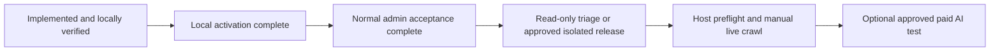

# Site Audit portal — implementation and local evidence

## Status and owner workflow

Implemented and verified against an isolated loopback PHP/MySQL installation, then **activated in the owner-approved local `ict` database and accepted through normal Apache/admin routes**. Local audit run #4 completed 199 pages with 1,803 findings. See `site-audit-local-activation-2026-10-16.md` for activation, real-admin evidence and preservation checks. No production host/domain was tested; no real API key, paid provider call, production release, commit or push was performed.

The existing `admin/site_audit.php` is now a responsive standalone portal with Overview, Issues, Pages & Media, AI Review and History. Existing navigation still points to that route. Workflow: **manual crawl → evidence review → optional paid recommendations → supported SEO comparison → explicit selected-field save → new audit**. Image findings open the existing Image Manager. SEO Manager deep links now open the requested supported record. Day Tours has no existing admin editor in this checkout, so its findings remain implementation tasks rather than linking to an invented form.

Title/description findings can generate a preview through the existing SEO service. Accepting a comparison creates a pending preview; only **Save this selected field** writes content. The current publication effect is displayed. Revisions, provenance, stale-edit rejection and restoration remain owned by SEO Manager; this portal introduces no alternate content save handler.

## Engine and evidence

- Inventory explicitly maps published destinations, itineraries, packages, experiences, day tours, blogs, country pages and static CMS pages. Guides/seasonal/generated routes are discovered from their existing sitemaps and public links. Private customer/account/inquiry/settings tables are excluded. Unpublished content contributes only route identifiers for detecting public links to drafts.
- Reconciles hero/cover/OG/video-poster assignments plus compatible destination/gallery/itinerary-day child media. Uses existing stored-media URL normalization. Empty hero assignments, broken files, loaded placeholders, likely generic fallback images, responsive variants and missing posters have separate evidence. Empty optional child image assignments are suggestions to review, not assertions that every day/gallery entry must have an image.
- Crawls public links, sitemaps and database routes with two browser pages concurrently. Defaults: 5,000 pages, 5,000 internal-link targets, 25 external-link targets. Additional caps: 100 sitemap documents, 1,000 collected elements of each DOM collection, 200 media elements/page, 10,000 unique resource probes, 10,000 inventory records/type and 10,000 child-media records/type. Limits are explicit partial coverage. Only safe version parameters on assets and numeric pagination parameters are accepted.
- Restricts browser navigation/resources to the configured site and path; blocks private and mutation routes, non-GET/HEAD requests, service workers and third-party browser resources. Forms are never submitted. External link probes validate destinations/redirects and reject private network addresses, including DNS resolution at connection time. HTTP probes have wall-clock deadlines. CLI requires an explicit target; it has no production-domain default.
- Observes robots restrictions, indexability declarations, canonical targets, sitemap mismatches, title/description duplication, headings, content markers, suspected soft 404s/topic overlap/orphans, JSON-LD syntax and supported fields/identity consistency, social metadata, resources, basic accessible names, mobile overflow and lab response timing. This is a bounded ruleset, not search-engine indexing/ranking proof, a complete accessibility certification, a legal review or real-user Core Web Vitals.
- Per-run public inventory, structured finding evidence, stable fingerprints, observations, review states and AI reviews use additive tables. Legacy issues remain readable without pretending they have structured observations. Ignoring needs a reason. Only completed comparable runs with complete configured coverage and an explicitly successful rule recheck can resolve an absent issue; other absences remain unverified. Compatibility includes configured target, rule profile and available inventory schema.
- Worker artifacts live outside the web/application roots in an application/database-specific temporary directory, with verified owner/service permissions. Windows creation restricts only the newly created audit directory; existing directories with unsuitable permissions fail closed. Polling retains the existing transaction, file lock and JSONL cursor guarantees, imports observations in the same transaction and recovers abandoned workers after the existing 30-minute inactivity threshold. Closing the browser does not cancel the worker.

## OpenAI boundary

Reuses the existing SEO session connection, configured model, fixed Responses endpoint, `store:false`, credential stamp/nonce, session revalidation, advisory lock, replay tokens, shared daily generation quota and token reporting. There is no second key store. Technical scans never call OpenAI. The connection must be made through SEO Manager in the same normal admin session.

AI reviews accept 1–20 selected findings only after displaying the exact bounded public context. The server recomputes its hash, removes query strings/private URLs/credential-like strings and validates every returned issue ID, enum, field and size. Crawled text is untrusted data; recommendations cannot execute tools or writes. Completed reviews are retained when a subsequent request fails. Failed/uncertain requests count against the existing quota; no paid retry occurs automatically. Provider retention rules remain independent of response storage. API-key expiry remains the existing SEO session policy, including its documented PHP-session-file limitations.

## Verified checks

- `composer validate`: passed.
- `composer test` with temporary `PHP_INI_SCAN_DIR` setting `session.save_path=C:/laragon/www/island/output/session`: **209 tests, 1,355 assertions, 14 existing skips**. The unconfigured command reproduces the pre-existing unwritable `C:/laragon/tmp` session failure. No system PHP configuration was changed.
- Targeted audit PHPUnit: **8 tests / 36 assertions**. JavaScript worker/rule tests: **8 passed**.
- Disposable MySQL rehearsal: **43 checks** covering migration rerun, published/child inventory, worker findings/variant failure, 429 uncertainty, import idempotence, triage, context bounds, quota/replay, model/storage/token controls, malformed provider output, disconnect during request, selective saves/revisions, stale edits, conservative comparisons and abandoned-worker recovery. OpenAI transport mocked throughout.
- Real Chromium at 1440 × 1000 and 390 × 844: **27 checks**, including actual worker startup/import, filtering, ignored reasons, context preview, mocked review and generation, comparison, pending preview, actual protected selective save, history, export and mobile fit. **No uncaught exceptions or unexpected portal HTTP failures.**
- HTTP/lifecycle: **14 checks**, including method/CSRF/body/shape boundaries, unknown/foreign IDs, hash mismatch, disconnected-key rejection, CSV export, duplicate runs and browser-close/new-session completion.
- Missing-schema browser/API: **4 checks**; missing-table notice, disabled launch, guarded API and no browser exceptions. No GET installs schema.
- Dynamic POST/route smoke: **73 passed, 0 failed/skipped**, using a fresh restricted temporary workbook spool removed afterward. Without that spool, the existing workbook-download case is an environmental failure.
- Broad PHP syntax sweep: **313 source/test files**; changed PHP/JavaScript syntax and scoped diff whitespace checks passed. Image-alt lint reports **six existing media-library records without alt text**, left unchanged.

Evidence: ignored `output/playwright/site-audit/`, `output/site-audit-integration.json`, `output/site-audit-phpunit.txt`, `output/site-audit-smoke.txt` and `output/site-audit-release/`. Fixtures use only `ict_audit_portal_rehearsal` on loopback with generated synthetic credentials. The temporary server, schema and worker artifacts are removed after verification.

## Activation, release and rollback

1. **Local activation and ordinary-admin acceptance are complete.** Only `2026-10-16-site-audit-portal.sql` was applied and recorded with its checksum. It preserves existing rows and adds missing progress columns through MySQL/MariaDB-compatible guards. Do not run the unrestricted migration runner against the dirty checkout merely to apply this file elsewhere: older/pending migrations may be unrelated, and the historical progress migration uses MariaDB-specific syntax.
2. Local Apache now uses the ignored, non-secret `output/site-audit-runtime.json` to locate the installed Playwright 1.62.1 packages and disable external-link probes for local acceptance. That file is read only for a non-production loopback application URL. Server deployments may set `SITE_AUDIT_NODE_MODULES` and optional `SITE_AUDIT_MAX_EXTERNAL_LINKS` instead. Private storage is separated by application, database and actual service identity; the normal Apache preflight passes. Production still requires its own Node/Playwright/Chromium installation and **Check host readiness**. Verify hosting background-process permission, memory/CPU/disk/time limits separately before enabling live scans.
3. Review the exact-scope packet. The four tracked audit files were clean at task start and match recorded `origin/main`; current local main remains behind upstream. The existing untracked SEO Manager is a dependency, not this feature's new code. Only the record-opening hunk is included for that file; its baseline hash is recorded. Do not deploy whole inherited shared files from the dirty checkout.
4. Separately approve production migration/release, production crawl and any real paid OpenAI acceptance test. Require approved backup/restore evidence and an isolated approved baseline, dependency/preflight success, normal admin auth, mobile browser acceptance and post-release asset checks. Physical-phone and production Apache/LiteSpeed acceptance are not certified by the loopback rehearsal.
5. App rollback restores the four audit files and removes the SEO deep-link hunk/new audit application files together. Retain additive audit/SEO tables, findings, reviews and content revisions. Stop or let active workers finish before switching versions. Content rollback uses the existing SEO revision restore; replacing portal files does not undo an explicitly saved content edit. No destructive down migration is proposed.

The ignored release packet includes a source/checksum manifest, scoped patch and an isolated apply/reverse-apply rehearsal. It is reviewable source, not authorization to release or a committed production candidate.

Later improvements: scheduled technical scans, Search Console/Bing imports, richer schema-specific rules, broader content edit coverage and measured real-user performance. They are outside this implementation.
